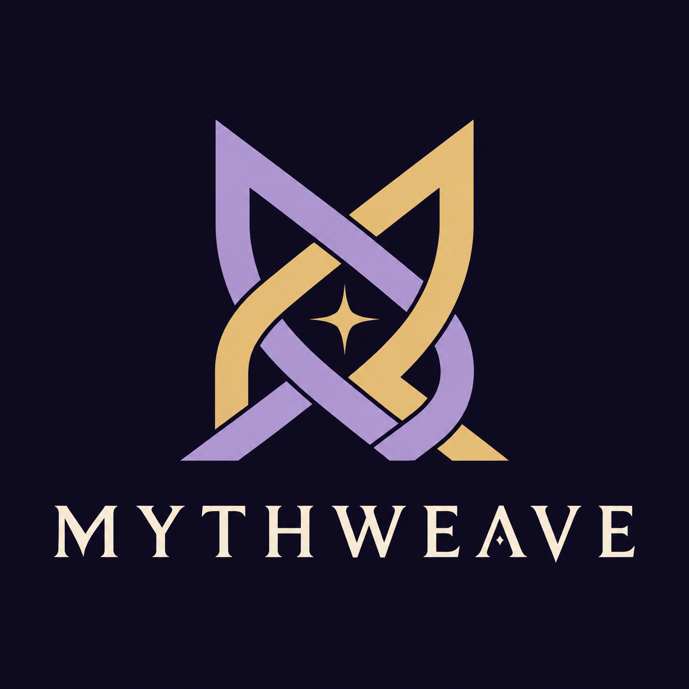
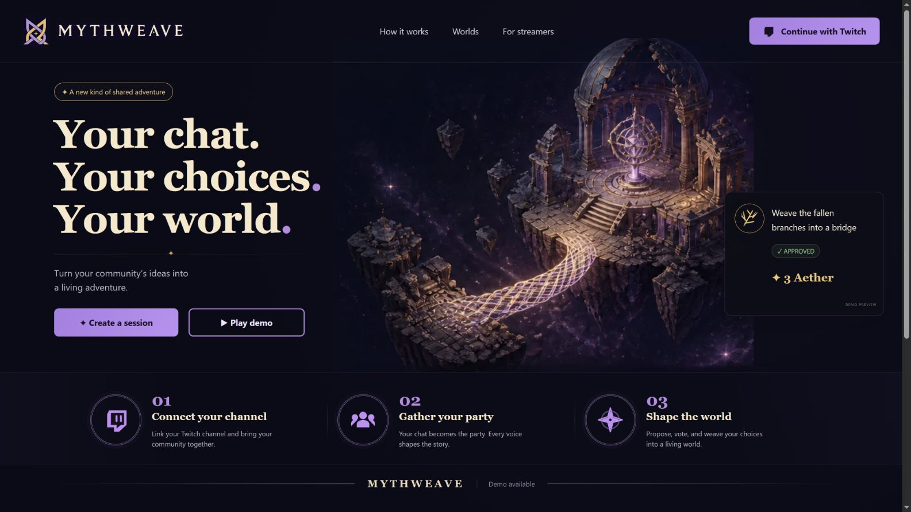
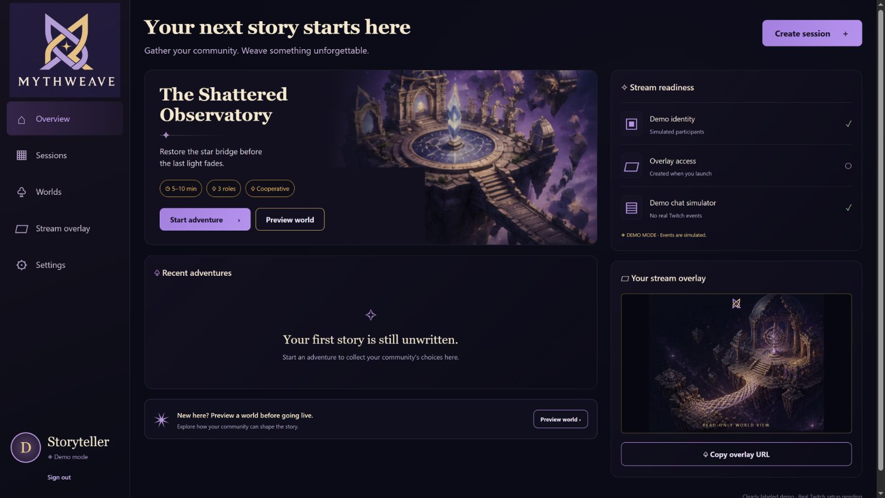
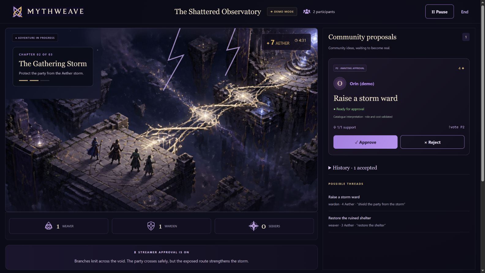
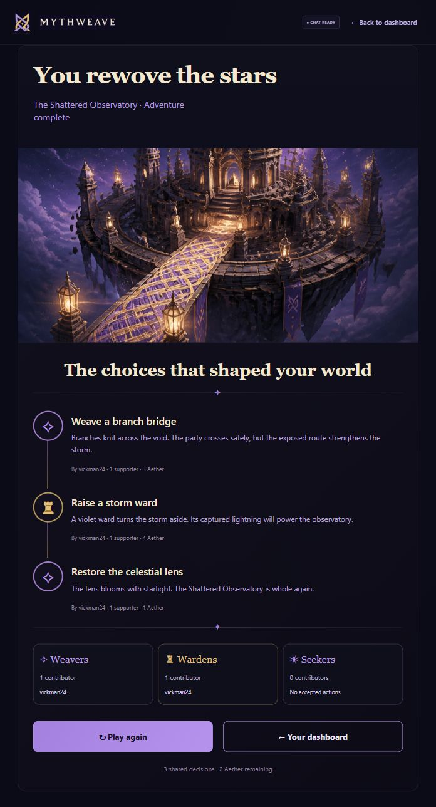
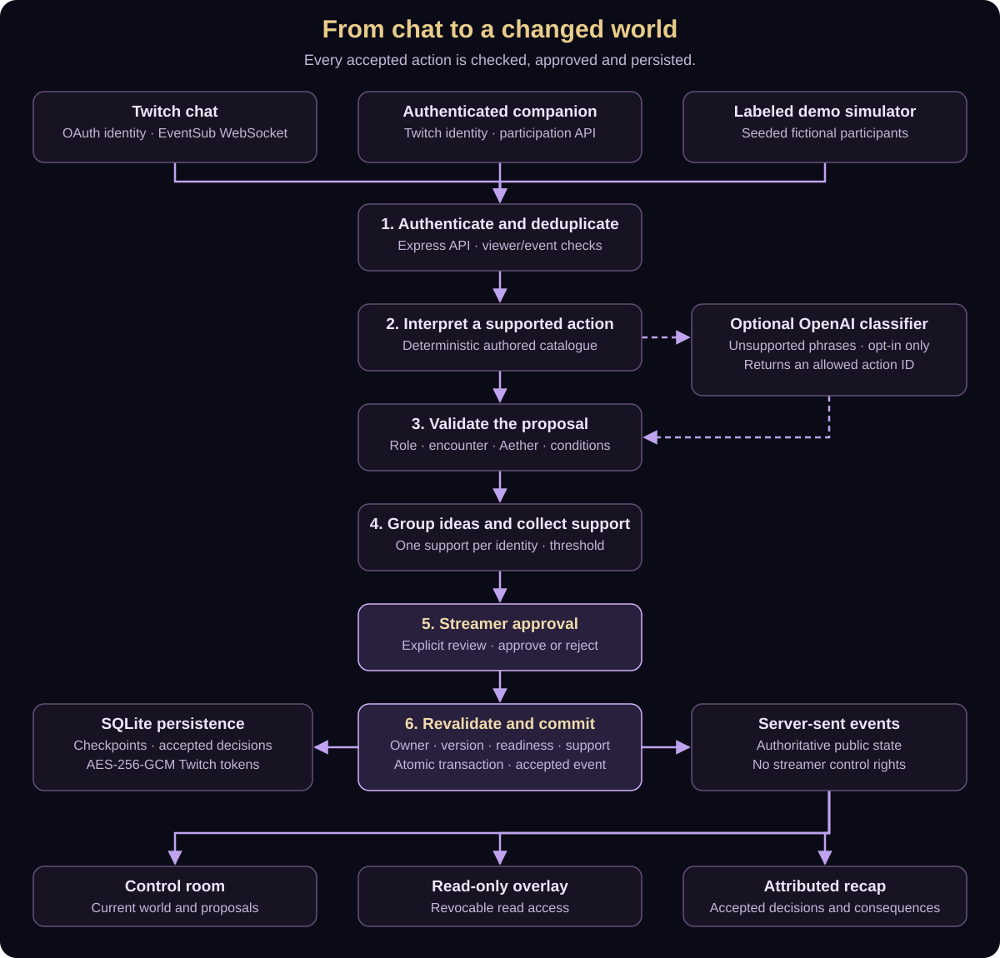

<div align="center">
  

# Mythweave

**Chat casts. Worlds change.**

[](https://github.com/vickman787/mythweave/actions/workflows/checks.yml)

A cooperative fantasy adventure where Twitch chat proposes the magic, the streamer approves the decisions, and those choices reshape a shared world.

[Quick start](#quick-start) · [How it works](#how-it-works) · [Live proof](#proof-and-verification) · [Twitch setup](#connect-a-real-twitch-channel) · [Architecture](#architecture) · [Documentation](#documentation)

</div>

## What is Mythweave?

A livestream audience has plenty of ideas. Mythweave gives those ideas consequences inside the adventure.

The party reaches a broken crossing. A viewer joins as a Weaver and proposes turning fallen branches into a bridge. Other participants can support it. The streamer reviews the action and its cost, then approves it. The bridge appears, the party advances, and the shared Aether supply falls.

That choice carries forward: the exposed bridge makes the next storm more expensive to survive. A Warden can capture that storm in a protective ward, making the final observatory restoration cheaper. The ending remembers who proposed each accepted action and what changed because of it.

The first adventure, **The Shattered Observatory**, is fully playable from the opening crossing to the final recap. A complete run through real Twitch chat has been verified locally.



## At a glance

| Area | Current implementation |
| --- | --- |
| Adventure | One authored world, three connected encounters, an eight-minute active timer and a shared supply of 10 Aether |
| Participation | Weaver, Warden and Seeker roles; chat proposals; one support per identity; configurable support threshold of 1, 2 or 3 |
| Streamer control | Explicit approval for every action, plus rejection, pause, resume and end controls |
| Twitch | OAuth identity, separately authorized chat scopes, EventSub WebSocket ingestion and implemented bot replies |
| Interface | Landing page, dashboard, setup, control room, read-only overlay, mobile companion and attributed recap |
| State | Server-owned rules, SQLite checkpoints, atomic accepted actions and server-sent updates |
| Interpretation | Deterministic authored-action matching; optional bounded OpenAI classifier, disabled by default |
| Local proof | Real Twitch account `vickman24` completed all three actions on October 25, 2026, ending with 2 Aether |
| Automated validation | TypeScript/production build and 14 passing tests; a GitHub Actions build/test workflow is included |
| Hosting | Runs locally; no public app deployment is claimed. Judges can run the repository without hosting it |

## Product tour

| Screen | What you can do |
| --- | --- |
| **Landing** | Explore the observatory, understand the three roles, continue with Twitch or enter the labeled demo |
| **Dashboard** | Check identity and chat readiness separately, inspect recent adventures, preview the world and prepare a session |
| **Setup** | Review the three chapters, choose the support threshold and launch when the selected mode is ready |
| **Control room** | Watch the world, timer and resources; review attributed proposals; approve or reject; pause or end the adventure |
| **Broadcast overlay** | Display a read-only world view using a revocable URL, without streamer controls |
| **Companion** | Open the session join link on another device, sign in with Twitch, choose a role, propose and support actions |
| **Recap** | See accepted decisions, their costs and consequences, credited contributors and remaining Aether |

The original Canva logo and illustration crops are included locally. Text, controls, validation, resource values and session state are rendered by the application; whole mockup screenshots are not used as functioning screens. See [asset provenance](public/brand/README.md) and the [design references](docs/design-reference).

### Streamer dashboard

The world card, recent-adventure empty state and connection readiness in the running app. This capture uses the clearly labeled Demo mode.



### Gameplay and streamer approval

An accepted branch bridge has opened the storm chapter. Orin's ward proposal is waiting for approval at a cost of 4 Aether. This is a real simulator run through the application, with Demo mode visible.



### Completed live Twitch adventure

The actual completed run by vickman24: bridge, storm ward and celestial lens, with three accepted decisions and 2 Aether remaining. This recap was captured after the verified real-chat run on October 25, 2026.



## How it works

1. **Start the adventure.** The streamer chooses a support threshold and launches the observatory.
2. **Join a role.** Viewers use `!join weaver`, `!join warden` or `!join seeker`.
3. **Propose an idea.** `!weave <idea>` maps the proposal to an authored action for the current encounter.
4. **Gather support.** Equivalent proposals group together. Each identity contributes at most one support, including the proposer's initial support.
5. **Review the decision.** The streamer sees the proposer, interpreted action, support and Aether cost.
6. **Approve the change.** The server rechecks ownership, current state version, role, support, resources and connection readiness before committing.
7. **See the consequence.** The scene changes, the next encounter opens, and the accepted decision becomes part of the recap.

### Roles and encounters

| Role | Contribution | Supported actions |
| --- | --- | --- |
| **Weaver** | Build and restore | Branch bridge, ruined shelter, celestial lens |
| **Warden** | Protect the party | Storm ward |
| **Seeker** | Reveal alternative routes and solutions | Hidden stepping stones, star runes |

| Chapter | Objective | Choice and resource consequences |
| --- | --- | --- |
| **1. The Broken Crossing** | Cross the shattered bridge | A branch bridge costs 3 Aether; hidden stepping stones cost 2. Choosing the bridge adds 1 to the next chapter's action costs |
| **2. The Gathering Storm** | Protect the party | The ward has a base cost of 3; shelter has a base cost of 2. After the bridge these become 4 and 3. The ward reduces the final chapter's action cost by 2 |
| **3. The Celestial Heart** | Restore the observatory | Restore the lens or align the star runes. Either has a base cost of 3, reduced to 1 after the ward |

The verified bridge → ward → lens route spends **3 + 4 + 1 Aether**, leaving **2**. The alternative path → shelter → stars route spends **2 + 2 + 3**, leaving **3**.

The timer counts eight minutes of active play. Pausing preserves time; proposals and approvals require an active adventure. Completing the third encounter wins the adventure. Running out of time ends it with the decisions already accepted still visible in the recap.

### Chat commands

Send each command as a separate Twitch chat message.

| Command | Purpose |
| --- | --- |
| `!join weaver` | Join or switch to Weaver |
| `!join warden` | Join or switch to Warden |
| `!join seeker` | Join or switch to Seeker |
| `!weave fallen branches into a bridge` | Propose the opening branch bridge as a Weaver |
| `!weave shield the party from the storm` | Propose the storm ward as a Warden |
| `!weave restore the celestial lens` | Propose the final lens restoration as a Weaver |
| `!vote P1` | Support the pending proposal with that ID; use the ID currently displayed in the queue |
| `!help` | Request command guidance |

Commands and role names are lowercase; proposal IDs use the displayed form, such as `P1`. Viewers must join a role before proposing or supporting. A proposer who changes roles must rejoin the action's required role before approval. Unsupported ideas receive guidance instead of creating arbitrary new rules.

## Proof and verification

### Real Twitch run

On **October 25, 2026**, the Twitch identity **vickman24** signed in, authorized chat and completed the adventure through real Twitch commands and control-room approvals.

| Accepted action | Cost | Aether after approval |
| --- | --- | --- |
| Weave a branch bridge | 3 | 7 |
| Raise a storm ward | 4 | 3 |
| Restore the celestial lens | 1 | 2 |

The application displayed **Adventure complete**, three shared decisions and attribution to the Twitch identity. The run is recorded in [the implementation notes](docs/MILESTONES.md).

The [live recap screenshot](docs/screenshots/live-recap.jpg) is displayed in the product tour above; the [original evidence capture](docs/live-victory.jpg) is also retained.

### What the evidence covers

| Check | Evidence and limits |
| --- | --- |
| Real Twitch identity and chat ingestion | Successful local OAuth, chat readiness and three real-command actions in the completed run |
| Complete game flow | Browser demo and real Twitch victory; both end with the expected state and attributed recap |
| Alternative route | Automated path → shelter → stars game test |
| Action authority | Automated role, resource, stale-state, ownership, support and duplicate-handling checks |
| Persistence and access boundaries | SQLite rollback/checkpoints and HTTP integration tests covering CSRF, concurrent approvals, overlay isolation/revocation and restart recovery |
| Twitch recovery logic | Automated local mock EventSub server; this does not prove every recovery case on Twitch itself |
| Optional AI classifier | Synthetic provider-response tests; no live model interpretation is claimed |
| Desktop/mobile | Local visual inspection, including a 390px mobile layout |
| Still to verify | A separate real viewer, bot reply delivery, actual OBS synchronization, platform token/reconnect/revocation cases and production behavior |

The live account currently serves as the bot in its own channel. The completed local run demonstrates the integration with that account; it is not a production load test or proof of independent multi-viewer participation.

## Quick start

### Requirements

- **Node.js 24+** and npm. Node 24.15 was used for local validation.
- A modern browser.
- Outbound HTTPS/WebSocket access for real Twitch operation.

SQLite is provided by Node's built-in `node:sqlite` module. You do not need a separate database server, Python, Docker, Twitch credentials or an OpenAI key to try Demo mode.

From the repository root:

```sh
npm ci --include=dev
npm run dev
```

Open **http://localhost:3010** and click **Play demo**. No environment file is required for the credential-free demo. If you already have an environment file, keep `ENABLE_MODEL=0` while testing without paid interpretation.

### Complete a demo in a few minutes

1. Enter Demo mode, start an adventure and leave support at **1** for solo testing.
2. Select **Luna** in the demo simulator. Click `!join weaver`, enter `!weave fallen branches into a bridge`, and send it. Approve the resulting proposal.
3. Select **Orin**. Join Warden, send `!weave shield the party from the storm`, and approve it.
4. Select **Luna** again. Send `!weave restore the celestial lens` and approve it.
5. Confirm the recap shows three accepted decisions and **2 Aether remaining**.

**Demo mode uses seeded fictional identities and simulated commands.** It runs the same game rules but does not prove a Twitch connection. Use **Pause** while reading; resume before submitting another command.

To try voting, choose threshold **2**, submit with Luna, then join Orin to a role and send `!vote P1` for the displayed proposal. Repeating Orin's vote cannot increase support.

## Connect a real Twitch channel

### 1. Configure the developer application

Create a confidential application in the [Twitch developer console](https://dev.twitch.tv/console/apps). Register this exact local OAuth redirect:

```text
http://localhost:3010/auth/twitch/callback
```

Create your local environment file:

```sh
cp .env.example .env
```

PowerShell equivalent:

```powershell
Copy-Item .env.example .env
```

Fill in `TWITCH_CLIENT_ID` and `TWITCH_CLIENT_SECRET`. Generate a persistent encryption key:

```sh
node -e "console.log(require('crypto').randomBytes(32).toString('hex'))"
```

Put that generated 64-character hex value in `TOKEN_KEY`. Keep these values in the local environment, then restart the server so it loads the configuration. `npm run doctor` reports configured flags without printing credential values.

### 2. Sign in, then authorize chat

1. Click **Continue with Twitch**. Identity sign-in uses an authorization-code flow with no identity scopes.
2. On the dashboard, click **Authorize chat**. This separately requests `user:read:chat` and `user:write:chat` for the same signed-in account.
3. Wait until chat readiness says **ready**. Readiness means the EventSub WebSocket subscription was created successfully; signing in alone is not enough.
4. Start a live adventure with threshold **1** for the initial check.

This implementation uses the streamer account as its own channel's reader and bot. It does not require a second bot account. EventSub uses an outbound WebSocket connection rather than an inbound webhook.

### 3. Complete the live adventure

Open your Twitch channel's chat in another tab. Send each line separately and approve each proposal in Mythweave **before** moving to the next chapter:

```text
!join weaver
!weave fallen branches into a bridge
```

Approve the bridge, then:

```text
!join warden
!weave shield the party from the storm
```

Approve the ward, then:

```text
!join weaver
!weave restore the celestial lens
```

Approve the lens. The expected result is **Adventure complete**, three accepted actions and **2 Aether remaining**. No vote command is necessary at threshold 1 because the proposer's initial support counts.

## Overlay and mobile companion

### OBS browser source

From the dashboard or control room, obtain the session's overlay URL. Add it to OBS as a **Browser** source with a suggested size of **1920 × 1080**, keeping the app server running on that computer for local use.

The overlay reads the same public session state and updates through server-sent events. It cannot approve actions or control the game. Its opaque URL grants read access: keep that URL private, and use **Revoke overlay links** to invalidate it. Revocation also ends authorized existing streams on a subsequent broadcast or heartbeat.

The browser-facing overlay and revocation boundaries are automated-test covered; actual OBS synchronization remains a manual check.

### Companion participation

The control room provides an **Open companion page** link. A real viewer signs in with Twitch before joining a role, proposing or supporting. Typed display names cannot grant participation rights. A demo companion page points back to its owner's simulator rather than pretending to be a live viewer.

The default server binds to loopback. A phone on another device cannot reach your computer's `localhost`; remote companion use needs an appropriately configured reachable origin. Public hosting is optional for running or reviewing the local application.

## Architecture



[Editable Mermaid source](docs/architecture.mmd). The diagram is stored as an SVG so it can be viewed without a Mermaid renderer.

### Why this design

**One server owns the game.** Browser controls request changes; they do not set Aether, accept proposals or choose an ending directly. Approval revalidates the latest state so a stale tab or concurrent request cannot apply an action twice.

**A bounded catalogue keeps choices understandable.** The six authored actions have known roles, costs, consequences and visual effects. Natural language helps participants express a supported idea; it does not create arbitrary executable behavior.

**Accepted changes are transactional.** SQLite uses WAL mode and `BEGIN IMMEDIATE` transactions. A failed mutation rolls back. Accepted events retain action, sequence, state version, attribution, support count, cost and timestamp.

**The world is shared through SSE.** The control room and overlay consume authoritative public snapshots. The public shape omits owner credentials and internal deduplication/participation details.

**Local operation stays small.** A single Node process, bundled frontend and one SQLite file are sufficient. Persistent storage and live connections are deliberate deployment constraints, not separate services required for a demo.

### Stack

| Layer | Technology | Purpose |
| --- | --- | --- |
| UI | React 19, TypeScript and CSS | Responsive screens, accessible controls and state-driven presentation |
| Frontend tooling | Vite 7 | Local development and production bundle |
| World presentation | Original Canva illustration crops with SVG state effects | Authored environments, bridge/ward/restoration feedback and original branding |
| Application server | Node.js 24 and Express 5 | OAuth, access checks, game controls and API routes |
| Persistence | Built-in `node:sqlite` | Games, browser sessions, encrypted Twitch tokens and checkpoints |
| Twitch transport | `ws`, Twitch OAuth and EventSub | Authenticated command ingestion and chat integration |
| Browser synchronization | Server-sent events | Authoritative session updates |
| Optional language mapping | OpenAI Responses API with strict structured output | Map an unsupported phrase to an allowed action ID |
| Validation | Node test runner, TypeScript and GitHub Actions | Rules, failure cases, integration boundaries and build checks |

## Configuration

| Variable | Default | Purpose |
| --- | --- | --- |
| `PORT` | `3010` | HTTP listener port |
| `HOST` | `127.0.0.1` | Bind address; containers normally use `0.0.0.0` |
| `APP_URL` | `http://localhost:<PORT>` | Canonical origin used for OAuth, links and request-origin checks |
| `DB_PATH` | `data/mythweave.sqlite` | Persistent SQLite file |
| `TOKEN_KEY` | Temporary local key when unset | Persistent 32-byte hex key for token encryption; required in production |
| `TWITCH_CLIENT_ID` | Unset | Your Twitch application's client ID |
| `TWITCH_CLIENT_SECRET` | Unset | Your Twitch application's server-side secret |
| `ENABLE_MODEL` | Disabled unless `1` | Opt in to paid runtime interpretation |
| `OPENAI_API_KEY` | Unset | Server-side key for optional model interpretation |
| `OPENAI_MODEL` | `gpt-4o-mini` | Model used by the optional classifier |
| `NODE_ENV` | Not production unless explicitly set | `production` requires HTTPS `APP_URL` and a persistent `TOKEN_KEY` |

Environment changes require a server restart. `.env`, local databases, dependencies and private recording material are excluded from Git. Do not replace another operator's working `.env` when following the copy example.

### Optional AI interpretation

The core adventure works without an OpenAI key. To opt in, set `ENABLE_MODEL=1` and provide `OPENAI_API_KEY` on the server.

The interpreter first tries the deterministic catalogue. Only an unsupported `!weave` phrase from a joined participant in an active adventure can reach the model fallback. Its strict schema permits one current-encounter action ID or `unsupported`.

The model cannot approve a proposal, spend Aether, change a role or mutate state. The server rejects malformed, refused, incomplete, extra-field and wrong-encounter responses and rechecks all game rules afterward. Failures fall back to catalogue guidance.

Requests use a six-second timeout, a per-participant ten-second cooldown and a process-wide ceiling of 60 calls per hour. The request contains the bounded idea and authored catalogue, not Twitch tokens or viewer IDs, and uses `store: false`. Actual paid runtime interpretation has not been verified; provider-response tests use fixtures.

## Security and recovery boundaries

| Boundary | Implementation |
| --- | --- |
| OAuth | One-time state, ten-minute expiry, bound to an HttpOnly SameSite cookie |
| Browser authentication | Server-side sessions with 24-hour expiry; secure cookies in production |
| Mutating API requests | Same-origin checks and authenticated access; owner-only game controls |
| Chat identity | Twitch-provided chatter ID; demo aliases restricted to the owning demo session |
| Approval | Owner, game version, active status, chat readiness, current encounter, proposer role, support and Aether are checked again |
| Duplicates | Bounded event-ID history, one support per identity and equivalent-idea grouping |
| Credentials | Twitch tokens encrypted with AES-256-GCM; keys remain server-side |
| Overlay | Opaque read-only capability with rotation/revocation; no control rights |
| Interrupted sessions | Stored checkpoints survive; server restart or a lost live connection pauses active adventures |
| Retention | Bounded command deduplication data and accepted decisions; unrestricted chat history is not retained |

Keep `TOKEN_KEY` stable: changing it makes previously stored Twitch tokens unreadable and requires reauthorization. OAuth flow state and rate-limit counters are process-local. This application is designed for **one server process**, not multiple workers sharing the same game database.

## Development and tests

| Command | What it does |
| --- | --- |
| `npm run dev` | Start the local Express/Vite development server |
| `npm run build` | Run strict TypeScript checking and build the frontend |
| `npm test` | Run the 14 game, persistence, HTTP, interpreter and Twitch protocol tests |
| `npm run doctor` | Print setup flags without displaying credential values |
| `npm run format` | Format source and test files with Prettier |
| `npm start` | Start the application server; production requires a previously built frontend |

```sh
npm run build
npm test
```

The latest local validation passed both commands. The [GitHub Actions workflow](.github/workflows/checks.yml) runs dependency installation, the build and tests on pushes and pull requests; a remote CI result is not claimed before the repository is published and the workflow runs.

The tests cover the two complete adventure routes, role/resource boundaries, duplicate delivery and votes, support thresholds, stale/concurrent approvals, paused time and expiry, transactional rollback, token encryption, HTTP identity and CSRF, overlay isolation/revocation, restart persistence, bounded model responses and a mock EventSub lifecycle. Automated tests do not replace the real Twitch verification above.

## Repository layout

```text
.github/workflows/       Build and test workflow
src/
  main.tsx              Routes, session controls and live state wiring
  game.ts               Shared game types, action catalogue and authoritative rules
  Landing.tsx           Branded landing page
  Dashboard.tsx         Readiness, recent sessions and world selection
  Companion.tsx         Authenticated participation flow
  Recap.tsx             Accepted decisions and contributor credits
  ReferenceWorld.tsx    SVG scene composition and state-driven effects
  Brand.tsx             Original logo viewports
  SceneArt.tsx          Illustration-only crops
  style.css             Base styles
  reference.css         Canva-aligned layouts and responsive presentation
server/
  index.ts              Express routes, OAuth, command intake and SSE
  twitch.ts             Token lifecycle, EventSub and chat integration
  interpreter.ts        Optional bounded model interpretation
  store.ts              SQLite transactions, sessions and token encryption
public/
  brand/                Original logo and provenance
  art/                  Locally bundled illustration sources
  favicon.svg           Original emblem favicon
scripts/doctor.mjs      Credential-safe setup diagnostics
tests/                  Rules, HTTP, model and Twitch protocol checks
docs/                   Setup, evidence, design references and submission notes
Dockerfile              Optional single-process container packaging
.env.example            Empty configuration template
```

## Troubleshooting

| Symptom | What to check |
| --- | --- |
| Sign-in returns a network error | The Node server needs outbound HTTPS access to Twitch. In a restricted development sandbox, restart it with permitted network access; browser access alone does not provide server connectivity |
| OAuth redirect mismatch | Register exactly the callback derived from `APP_URL`, including scheme, host, port and path. Do not interchange `localhost` and `127.0.0.1` |
| Signed in but chat disconnected | Complete **Authorize chat** for the same account, wait for **ready**, and use **Reconnect** if needed |
| A live adventure cannot launch | Chat subscription readiness is required; identity sign-in by itself is insufficient |
| A command is refused | Confirm the adventure is active, join the required role, use a supported current-chapter action and check remaining Aether |
| Approval needs more support | Use another joined participant to support the displayed pending proposal. The proposer already counts once |
| Approval reports stale state | Review the latest queue; another approval may already have moved the party to the next chapter |
| The adventure ends while reading | Use **Pause** and resume before sending the next command. Active play has an eight-minute limit |
| Tokens stop working after restart | Restore the same persistent `TOKEN_KEY`, or authorize chat again |
| An overlay link stops loading | It may have been revoked. Obtain the current link from the owning dashboard/control room |
| Port 3010 is occupied | Choose another `PORT`, update `APP_URL` to match, and register the matching Twitch callback |

## Optional deployment

A hosted URL is not required to run or judge the project locally. If you choose to deploy, use **one long-running Node 24 process** with HTTPS and persistent SQLite storage. GitHub Pages/static-only hosting and short-lived serverless handlers cannot host the complete application as written.

Build with `npm ci --include=dev` and `npm run build`, then run `npm start` with `NODE_ENV=production`, an HTTPS `APP_URL`, a persistent `TOKEN_KEY` and the required Twitch credentials. Register the public callback in Twitch. Preserve SSE connections through the reverse proxy and permit outbound HTTPS/WSS.

A Dockerfile is included. Container use requires `HOST=0.0.0.0` and a writable persistent volume at `/app/data`. The image has not been built or deployed in this environment. See [the deployment notes](docs/SETUP.md#deployment-plan) for the full example.

## Built with Codex

Mythweave was developed with OpenAI Codex from a product brief and the user's Canva presentation. Codex helped implement the React screens, authoritative game rules, SQLite persistence, Twitch OAuth/EventSub integration, optional classifier, tests, setup documentation and failure handling.

The build was verified through browser demo runs and a human-driven live Twitch test. That test exposed a server network restriction; fixing the server's connectivity enabled real sign-in and chat. Browser checks also caught chapter-specific command guidance and a time-sensitive test assumption, which were corrected.

**Main build session:** provided separately in the Devpost submission.

The development agent and the optional runtime classifier have different roles: Codex helped build the application; the optional model only suggests an allowed interpretation during play. The adventure does not require paid runtime AI to work.

## Scope and next steps

The current scope is one complete authored adventure. It does not generate arbitrary worlds or execute viewer-supplied code.

Next validation work includes independent viewer participation, bot reply confirmation, OBS synchronization and real platform recovery cases. Product extensions could add more authored adventures, richer animation/audio and replayable recaps. Public hosting is optional; the repository and local setup remain the reproducible way to inspect the current build.

## Documentation

| Document | Contents |
| --- | --- |
| [Setup and operations](docs/SETUP.md) | Twitch configuration, storage, recovery, optional interpretation and deployment |
| [Implementation and evidence](docs/MILESTONES.md) | Milestones, validation record, live result and remaining checks |
| [Original product brief](docs/PRODUCT_BRIEF.md) | Preserved build brief and original design requirements; historical intent rather than current status |
| [Submission draft](docs/SUBMISSION.md) | Project description, evidence and fields still needing final values |
| [Demo recording plan](docs/DEMO_SCRIPT.md) | Planned walkthrough and recording checklist; not a finished video |
| [Brand provenance](public/brand/README.md) | Original Canva logo source and usage |
| [CI workflow](.github/workflows/checks.yml) | Automated build and tests |

## Assets and licensing

The repository includes the user's supplied Canva logo and illustration sources. Their provenance is documented; inclusion does not establish a separate open-source license for third-party artwork. No repository-wide code license has been selected yet. Dependency licenses remain with their respective authors.
